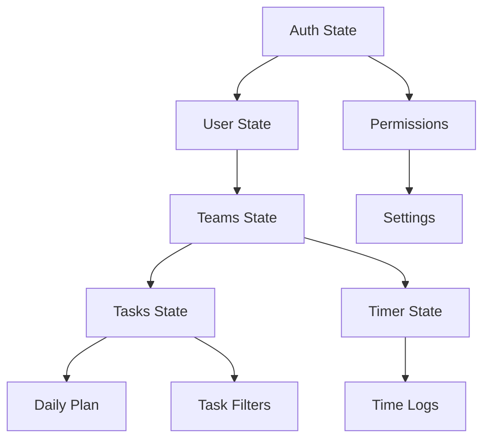

# State Management

The web app holds state with two libraries, each for one job:

- **[Jotai](https://jotai.org)** holds the state the app shares between components: the active team, the running timer, the task list, the open panels.
- **[TanStack Query](https://tanstack.com/query)** (React Query) reads from the API and keeps what it read: caching, retries, refreshing after a write.

Earlier versions used Recoil. It is no longer used.

## Why two libraries

| Need | Library | What it gives |
| --- | --- | --- |
| State many components read | Jotai | Small independent atoms: a component re-renders only for the atoms it reads |
| Data from the API | TanStack Query | One cache per query key, loading and error states, retries, invalidation after a write |
| A value kept between visits | Jotai (`atomWithStorage`) | An atom saved in the browser's storage |

## Store Organization

Atoms are organized by domain in `core/stores/`:

```
core/stores/
├── index.ts          # Re-exports the stores
├── auth/             # Permissions, workspaces
├── calendar/         # Calendar grid settings
├── common/           # Shared interface state: menu, languages, time zones, shortcuts, command palette
├── daily-plan/       # Daily plans
├── integrations/     # Integrations and their tenant settings
├── settings/         # Workspace data export
├── tasks/            # Task filters, views, the task drawer, optimistic updates
├── teams/            # Teams, the active team, the team's tasks
├── timer/            # The timer, its notes and labels, time logs, time limits
└── user/             # The signed-in user, employee, organizations
```

`core/stores/README.md` in the repository has the naming rules for new atoms.

## Common Patterns

### An atom

```typescript
import { atom } from 'jotai';
import { TTask } from '@/core/types/schemas/task/task.schema';

export const teamTasksState = atom<TTask[]>([]);
export const activeTeamTaskState = atom<TTask | null>(null);
```

An atom has no key to register: it is identified by the variable that holds it.

### Reading and writing an atom

```typescript
import { useAtom, useAtomValue, useSetAtom } from 'jotai';
import { activeTeamTaskState, teamTasksState } from '@/core/stores';

function ActiveTaskTitle() {
	// Read only: the component re-renders when the active task changes
	const activeTask = useAtomValue(activeTeamTaskState);
	return <span>{activeTask?.title}</span>;
}

function useClearTasks() {
	// Write only: the component does not re-render when the list changes
	const setTasks = useSetAtom(teamTasksState);
	return () => setTasks([]);
}
```

`useAtom` gives both, like `useState`.

### Reading from the API

A read is a query hook. It names its query key, calls a service, and returns the data with its loading state:

```typescript
import { useQuery } from '@tanstack/react-query';
import { queryKeys } from '@/core/query/keys';
import { rolePermissionService } from '@/core/services/client/api/roles/role-permission.service';

export function useRolePermissionsQuery(roleId?: string) {
	const { data, isLoading } = useQuery({
		queryKey: queryKeys.roles.permissions(roleId!),
		queryFn: () => rolePermissionService.getRolePermission(roleId!),
		enabled: !!roleId
	});

	return { rolePermissions: data?.items ?? [], isLoading };
}
```

Query keys come from `core/query/keys`, so every hook that reads or refreshes the same data names it the same way.

### From a query to an atom

Many components read the atoms directly. So when data the whole app shares arrives from a query, the hook that owns the query copies it into its atom. A simplified version of what `useLanguageSettings` does:

```typescript
const { data } = useQuery({ queryKey: queryKeys.languages.byScope(tenantId, userId, isSystem), queryFn: fetchLanguages });
const setLanguages = useSetAtom(languageListState);

useEffect(() => {
	if (data) {
		setLanguages(data.items);
	}
}, [data, setLanguages]);
```

This is the app's convention, on purpose: the atom is the one place the rest of the app reads from, and the query stays the one place that talks to the API. Do not replace it with reads of the query in every component.

### Writing to the API

A write is a mutation. When it settles, it invalidates the queries it changed, and they read again:

```typescript
import { useMutation } from '@tanstack/react-query';

export function useUpdateRolePermission(roleId?: string) {
	const { invalidateRolePermissions } = useInvalidateRolePermissions();

	const mutation = useMutation({
		mutationFn: rolePermissionService.updateRolePermission,
		onSettled: () => {
			if (roleId) {
				invalidateRolePermissions(roleId);
			}
		}
	});

	return { updateRolePermission: mutation.mutate, updateRolePermissionLoading: mutation.isPending };
}
```

### Hooks are the interface

Components do not call services or build queries themselves. A custom hook in `core/hooks/` holds the query or the mutation, the atoms it fills and the logic around them, and a component calls the hook.

## State Dependencies



## Best Practices

1. **One concern per atom.** Keep an atom to a single piece of state, and name it after what it holds.
2. **Keep atoms plain.** Logic belongs in the hooks of `core/hooks/`.
3. **One owner per query.** The hook that owns a query fills its atom; other code reads the atom or calls that hook.
4. **Invalidate after a write.** A mutation names the queries it changed, so no screen keeps an old answer.
5. **Use the shared query keys.** A key written by hand in one place is a refresh missed in another.
