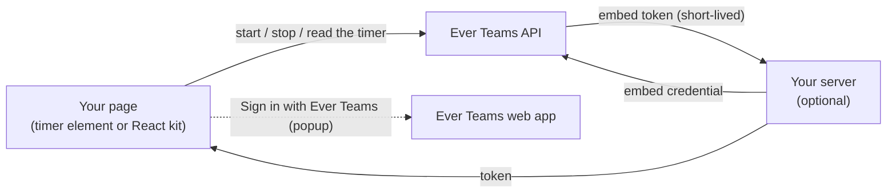

# Embed the Timer on Your Site

You can show a person's Ever Teams timer inside your own product: they start and stop their time where they already work, and the time lands in their Ever Teams workspace like any other entry.

This page covers the three ways a page can sign a person in, what an administrator sets up first, and the timer element for pages that do not use React.

:::info Status
The pieces described here live in the `ever-teams` repository on the `develop` branch. `@ever-teams/api` and `@ever-teams/atoms` are published on npm, and a feature described here can be newer than their latest release: check the package's changelog. The `<ever-teams-timer>` element (`@ever-teams/embed`) is **not published on npm yet**: you serve its built files from your own site, as explained below.
:::

## How it fits together



A page never holds a long-lived secret. It holds a short-lived timer token for one person, and that token only works from a site the organization allows.

## What an administrator sets up

In the web app, an administrator of the organization opens **Settings > Workspace > Embeds** and:

1. Adds your site to the **allowed sites** (its origin, for example `https://app.example.com`, without a path).
2. For the server path: creates an **embed credential** (it starts with `gze_`). It belongs on your server, in an environment variable, and never in a page.
3. For the popup path: turns on **People can sign in from this site** for that site.

Ever Teams refuses a person who has no account, has time tracking turned off, or is no longer a member of the organization. The refusal carries the code `EMBED_MEMBER_NOT_ALLOWED`, and the timer tells the person to ask their admin.

## Choose how people sign in

| Your situation | Use | What the person does |
| --- | --- | --- |
| Your product has a server and already knows who is signed in | A token from your server (`token-url`) | Nothing: no password or token is typed in your page |
| Your page has no server of its own | The **Sign in with Ever Teams** button (`sign-in="ever-teams"`) | Signs in to Ever Teams in a popup and allows your site, once |
| A quick trial, or an internal page | The kit's own sign-in | Types their Ever Teams email and password, or pastes a token |

### 1. A token from your server

Your server exchanges the embed credential for a token that reaches only one person's timer, from one site, for a short time (15 minutes by default, one hour at most). `@ever-teams/api/server` does it in one call:

```js
import { exchangeEmbedToken } from '@ever-teams/api/server';

const { token, expiresAt } = await exchangeEmbedToken({
	apiUrl: process.env.EVER_TEAMS_API_URL, // ends with /api
	credential: process.env.EVER_TEAMS_EMBED_CREDENTIAL,
	email: user.email, // the person signed in to your product
	origin: 'https://app.example.com' // one of the organization's allowed sites
});
```

Expose that as a route of your own site that answers `{ token, expiresAt }` for the signed-in person, with `Cache-Control: no-store`, and answers 401 when nobody is signed in. When Ever Teams refuses the person, answer 403 with `{ "code": "EMBED_MEMBER_NOT_ALLOWED" }` so the timer can say why.

Then point the timer at that route:

```html
<ever-teams-timer api-url="https://api.ever.team/api" token-url="/api/ever-teams-token"></ever-teams-timer>
```

The element asks your route with a `POST` and your page's cookies, signs the person in with the answer, and asks again shortly before the token expires.

:::tip
`exchangeEmbedToken` sets no time limit of its own. Give it a `fetch` that stops waiting, for example with `AbortSignal.timeout(10_000)`, so a slow API does not hold your own request open.
:::

The entry `@ever-teams/api/server` runs on a server only (Node 20 or later, or another runtime with `fetch` and no `document`). The [`@ever-teams/api` README](https://github.com/ever-co/ever-teams/tree/develop/packages/api#sign-people-in-from-your-server) has complete route handlers for Next.js and Express.

### 2. Sign in with Ever Teams

On a page without a server, the element shows a **Sign in with Ever Teams** button. It opens the Ever Teams web app in a popup, where the person signs in if they are not already and allows your site to start and stop their timer. The popup hands the element a timer token and a renewal token, then closes.

```html
<ever-teams-timer
	api-url="https://api.ever.team/api"
	sign-in="ever-teams"
	organization="your-organization-id"
	app-url="https://app.ever.team"
></ever-teams-timer>
```

- The timer token stays in memory. The renewal token is kept in the browser's storage for that API address and organization, so a reload stays signed in where the browser lets the page store it.
- The element renews the timer token about a minute before it expires.
- The user menu signs out. An administrator can also end it by removing the site, or turning its sign-in off, in **Settings > Workspace > Embeds**.

:::warning Shared computers
The sign-in is kept for the API address and organization, not for a user of your page. When your page signs its own user out, sign the timers out too, so the next person does not get the previous one's timer:

```js
await Promise.all([...document.querySelectorAll('ever-teams-timer')].map((timer) => timer.signOut()));
```
:::

### 3. The kit's own sign-in

Without `sign-in` or `token-url`, the element shows the kit's own form: the person types their Ever Teams email and password, or pastes a token. A person with two-factor sign-in on types the code of their authenticator app, or a recovery code, in the same form.

## The timer element

`<ever-teams-timer>` is the timer as an HTML element, for plain HTML, a site editor, Vue, Angular or Svelte. React, the kit and its styles are bundled in, so your page installs and builds nothing.

Build `packages/toolkit/embed`, serve the files of its `dist/` folder from your site, then add one script and one element:

```html
<script type="module" src="/ever-teams/ever-teams-embed.js"></script>

<ever-teams-timer api-url="https://api.ever.team/api"></ever-teams-timer>
```

### Attributes

| Attribute | Default | What it does |
| --- | --- | --- |
| `api-url` | `https://api.ever.team/api` | The Ever Teams API the timer talks to. With your own server, its address ending in `/api`. |
| `color-scheme` | `system` | `light`, `dark`, or `system`. |
| `lang` | `en` | The language of the timer and its sign-in: `en` or `fr`. |
| `sign-in` | none | `ever-teams` shows the Sign in with Ever Teams button. |
| `organization` | none | With `sign-in="ever-teams"`: the organization the site signs people in to. |
| `app-url` | `https://app.ever.team` | With `sign-in="ever-teams"`: the web app the popup opens. |
| `token-url` | none | Your own route that answers the signed-in person's embed token. It wins over `sign-in`. |

A change of attribute applies at once. Removing the element stops its display and its polling.

### Listen to the timer

The element dispatches `ever-teams-timer-change` when it first reads the person's timer, then each time a later read shows it changed, wherever the change was made (this timer, the web app, the desktop app):

```html
<p id="timer-status"></p>

<script>
	document.addEventListener('ever-teams-timer-change', (event) => {
		const status = document.getElementById('timer-status');
		if (event.detail.running) {
			status.textContent = `Working since ${event.detail.startedAt}`;
			return;
		}
		status.textContent = 'Not tracking time';
	});
</script>
```

`event.detail` holds `running`, `startedAt` (an ISO date, `null` while stopped), `projectId`, `taskId` and `initial` (`true` for the first read). The event comes from the reads the element already makes: on load, every minute while the page is visible, when the page becomes visible again, on focus and when the network comes back. It adds no request, and it is not a real-time feed: a start and a stop that both fall between two reads are not told.

### What it changes in your page

The timer draws in the element's own shadow root: your page's CSS does not reach it, and its styles do not reach your page. To give it your page's font, set `--ever-teams-kit-font` on the element or a parent:

```css
ever-teams-timer {
	--ever-teams-kit-font: Georgia, serif;
}
```

### Frameworks

- **Vue**: tell the compiler that `ever-teams-` tags are custom elements (`isCustomElement`).
- **Angular**: add `CUSTOM_ELEMENTS_SCHEMA` to the component that holds the element, and bind values with `[attr.color-scheme]`.
- **Svelte**: no setting needed; load the package in `onMount`.
- **Server rendering**: load the package in the browser only, since the element extends `HTMLElement`.

The repository has runnable examples for plain HTML, Vue, Svelte and Angular in [`packages/toolkit/embed/examples`](https://github.com/ever-co/ever-teams/tree/develop/packages/toolkit/embed/examples), and the package ships its TypeScript types.

## In a React app

A React app uses the kit directly instead of the element. [`@ever-teams/atoms`](https://github.com/ever-co/ever-teams/tree/develop/packages/toolkit/atoms) gives the same timer and sign-in as components, and takes the token of your server through `config.getToken`.

## Related

- [Ever Teams Kit overview](./index.mdx)
- [Time tracking](../features/time-tracking.md)
- [Authentication](../features/authentication.md)
- [`@ever-teams/embed` README](https://github.com/ever-co/ever-teams/tree/develop/packages/toolkit/embed)
- [`@ever-teams/api` README](https://github.com/ever-co/ever-teams/tree/develop/packages/api)
